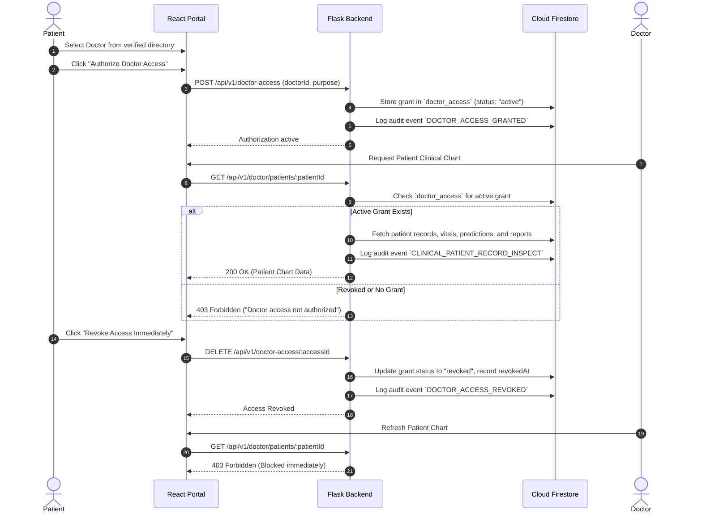

# System Architecture: Cloud-Based Healthcare Data Management System with AI-Powered Disease Prediction

**Repository:** [https://github.com/REDDIPALLIPHANIKOUSHIK/cloud_project](https://github.com/REDDIPALLIPHANIKOUSHIK/cloud_project)  
**System Classification:** Clinical Decision-Support & Healthcare Data Governance Platform  

---

## 1. High-Level Architectural Topology

The platform implements a multi-tier decoupled architecture designed for high availability, zero cross-patient data leakage, and low-latency clinical machine learning inference.

```
+-------------------------------------------------------------------------------------------------+
|                                         PRESENTATION TIER                                       |
|  React 18 + Vite + TypeScript + Tailwind CSS + Lucide Icons + Recharts + React Router 6         |
|                                                                                                 |
|  [Public Landing]           [Patient Portal]         [Doctor Clinical Portal]   [Admin Portal]  |
|  - Value proposition        - Health profile         - Permitted patient list   - Statistics    |
|  - Model credentials        - Records timeline       - Patient charts & vitals  - Role control  |
|  - Emergency advisory       - Document upload (drag) - Diagnostic scans review  - Verification  |
|  - 1-Click demo access      - 13-feature ML form     - Clinical note creation   - Audit stream  |
|                             - Specialist referral    - Prescription records                     |
|                             - Doctor consent manager                                            |
+-------------------------------------------------------------------------------------------------+
                                  |
                                  | HTTPS / REST API / Bearer Tokens
                                  v
+-------------------------------------------------------------------------------------------------+
|                                      APPLICATION & API TIER                                     |
|  Python 3 + Flask 3 + Flask-CORS + Pydantic v2 + Scikit-learn + Joblib                          |
|                                                                                                 |
|  [Security & Middleware]   [Core Route Blueprints]         [Clinical Services Engine]          |
|  - Bearer Token Auth Guard - /api/v1/health                - ModelService (RandomForest)        |
|  - Role Access Control     - /api/v1/predict               - SpecialistRecommender Engine       |
|  - Patient Scope Verifier  - /api/v1/medical-records       - EmergencySafety Layer (Red flags)  |
|  - Consent Grant Checker   - /api/v1/reports               - DatabaseService (Cloud/Hybrid)     |
|                            - /api/v1/doctor                - AuditService (Immutable logs)      |
|                            - /api/v1/admin                 - PDF/Report Generation Engine       |
+-------------------------------------------------------------------------------------------------+
                                  |
                                  | Server-Side Admin SDK / Client Cloud Connectors
                                  v
+-------------------------------------------------------------------------------------------------+
|                                      PERSISTENCE & CLOUD TIER                                   |
|  Cloud Firestore + Firebase Authentication + Firebase Storage (with local hybrid fallback)      |
|                                                                                                 |
|  [Cloud Firestore]                  [Firebase Storage]           [Firebase Authentication]      |
|  - users, patients, doctors         - Private patient documents  - Patient/Doctor accounts      |
|  - medical_records, lab_reports       (PDF, JPG, JPEG, PNG)      - Role claims                  |
|  - predictions, doctor_access       - Enforced storage.rules     - Password resets              |
|  - clinical_notes, audit_logs                                                                   |
|  - Enforced firestore.rules                                                                     |
+-------------------------------------------------------------------------------------------------+
```

---

## 2. Machine Learning Inference Pipeline

The disease prediction system utilizes a calibrated **Random Forest Classifier** trained on the gold-standard **UCI Cleveland Heart Disease benchmark dataset** (303 patient cases).

### Clinical Feature Pipeline
```
Patient Inputs (13 Features)
  age, sex, cp, trestbps, chol, fbs, restecg, thalach, exang, oldpeak, slope, ca, thal
       |
       v
Pydantic Validation (HeartDiseaseInput Schema)
       |
       +--> SimpleImputer (strategy='median')
       |
       +--> StandardScaler (Normalized feature distribution)
       |
       +--> RandomForestClassifier Pipeline (100 estimators, max_depth=4)
       |
       v
Output Probabilities & Class (0: No Coronary Disease, 1: Coronary Disease Risk)
       |
       +------------------------------------+------------------------------------+
       |                                    |                                    |
       v                                    v                                    v
Risk Stratification Tier         Emergency Safety Check            Specialist Recommendation
(Low, Moderate, Elevated, High)  (Independent Red-Flag Rules)     (Cardiologist, Pulmonologist,
                                 (Crushing chest pain, BP crisis)  Endocrinologist, GP)
```

### Measured Model Performance Metrics
- **Holdout Test Accuracy:** 90.16%
- **Precision:** 89.29%
- **Recall (Sensitivity):** 89.29%
- **F1-Score:** 89.29%
- **ROC-AUC Score:** 96.10%
- **Holdout Confusion Matrix:** `[[30, 3], [3, 25]]` (30 True Negatives, 25 True Positives, 3 False Positives, 3 False Negatives)

---

## 3. Patient Consent & Doctor Sharing Protocol

To guarantee patient data sovereignty, clinical records cannot be queried by doctors unless an active consent grant exists.



---

## 4. Emergency Safety Layer Architecture

The emergency safety module (`backend/app/services/emergency_safety.py`) screens for critical acute medical red flags:
1. **Reported Symptom Parsing:** Scans patient text for acute markers (e.g. crushing chest pain, radiating pain to left arm/jaw, severe dyspnea at rest, FAST stroke signs, acute syncope).
2. **Objective Vital Sign Thresholds:**
   - Systolic BP &ge; 180 mm Hg (Hypertensive urgency/crisis)
   - Resting HR &gt; 190 bpm (Extreme tachycardia)
   - ST depression &ge; 3.5 mm with typical angina and exercise induction.
3. **Safety Override Policy:** If triggered, the emergency alert displays prominently with direct dial instructions (<span style="color:red;font-weight:bold">112 in India / 911 in US</span>). Statistical ML model outputs are **never** permitted to downgrade an identified medical emergency.
